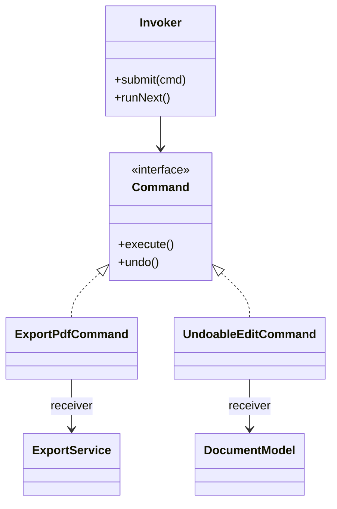

# Command — problem and solution

## Problem and forces

UI buttons, HTTP endpoints, and cron ticks all want the same side effect: start a file export, push a notification, call a payment-provider adapter. Forces collide:

- The *decision* to act (button click, webhook) must stay separate from *how* the act runs (sync, queued, retried).
- Some domains need undo (document editor) or replay (failed export).
- Auditing and idempotency need a stable description of “what was requested,” not a buried method call.

## Naive approach and why it fails

Call `exporter.run()`, `notifier.send()`, or `adapter.charge()` directly from every entry point. Queuing means copy-pasting argument lists into ad-hoc job payloads. Undo becomes “reverse engineer what the last call did.” Adding retry or logging edits every call site. The request itself has no identity.

## Solution

Represent each request as a Command object with an `execute()` (and optionally `undo()`). An Invoker (button, controller, worker) holds and runs commands without knowing receivers. Receivers (export service, notifier, editor document, payment adapter) perform the real work. History stacks store commands for undo/redo or audit.

## Analogy (original)

A document editor’s toolbar does not rewrite the document. It drops a slip — “bold selection,” “insert table,” “export PDF” — into an outbox. A runner later executes slips in order; an undo shelf keeps prior slips so the editor can reverse them. The slip *is* the Command: portable, loggable, reversible.

## Structure

| Participant | Role |
|-------------|------|
| Command | Interface: `execute` (optional `undo`) |
| ConcreteCommand | Binds a receiver + arguments; performs one action |
| Invoker | Stores / queues / triggers commands (UI, worker, scheduler) |
| Receiver | Domain object that knows how to do the work |
| Client | Creates concrete commands and assigns them to invokers |

