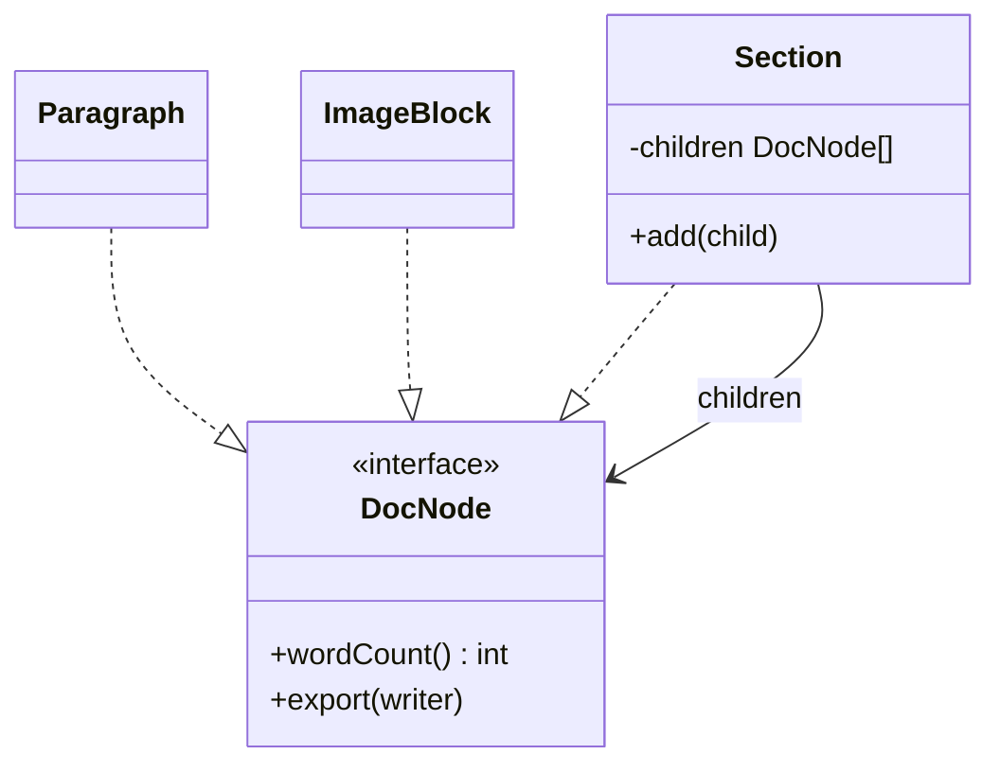

# Composite — problem and solution

## Problem and forces

A document model mixes text runs, images, and sections that contain other nodes. Export and word-count must work on a single paragraph or an entire chapter. Forces: one client API for "any node," recursive structure, leave leaf code free of child-management details.

## Naive approach and why it fails

Separate types with `if (node instanceof Section)` everywhere, or force clients to recurse manually. Fails when a new node kind appears and every walker gains another branch; clients leak tree knowledge.

## Solution

Define a Component interface with the shared operations. Leaves implement them directly. Composites store children as Components and forward operations (often aggregating results). Clients depend only on Component.

## Analogy (original)

A playlist can be one track or a folder of playlists. Hitting "total duration" on either yields a number: a track returns its length; a folder sums its children. The stereo UI never asks "is this a folder?"

## Structure

| Participant | Role |
|-------------|------|
| Component | Common operations for leaves and composites |
| Leaf | No children; does the real work |
| Composite | Holds children; delegates / aggregates |
| Client | Talks only to Component |

