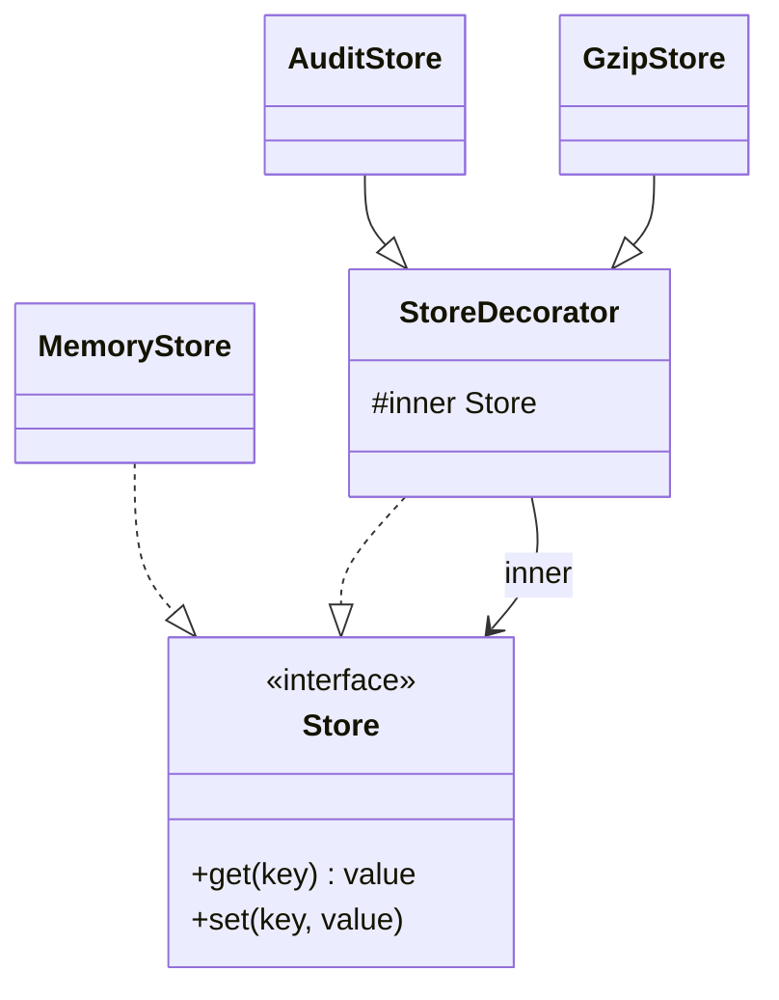

# Decorator — problem and solution

## Problem and forces

A cache `Store` supports `get`/`set`. Product needs optional metrics, gzip of values, and audit logging — in different combinations per environment. Forces: keep `Store` interface stable, stack features without an inheritance matrix, enable/disable layers at the composition root.

## Naive approach and why it fails

Subclass every combination, or bolt flags into one "god store" (`if ($this->log) …`). Fails when combinations grow and when tests cannot isolate a single concern.

## Solution

Each Decorator implements `Store`, holds an inner `Store`, and adds one concern before/after forwarding. Compose `new AuditStore(new GzipStore(new MemoryStore()))`.

## Analogy (original)

A courier pouch can gain a waterproof sleeve, then a tracking sticker, then a signature sleeve. Each sleeve wraps the same pouch opening — the recipient still opens "a pouch," unaware how many sleeves were added.

## Structure

| Participant | Role |
|-------------|------|
| Component | Shared interface |
| ConcreteComponent | Core behavior |
| Decorator | Implements Component; wraps another Component |
| ConcreteDecorator | Adds one concern |

