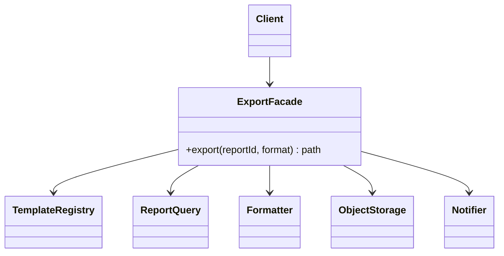

# Facade — problem and solution

## Problem and forces

Exporting a report touches a template registry, a query service, a CSV/PDF formatter, an object-storage client, and a notifier. Controllers and jobs copy the same six-line sequence. Forces: one entry point, hide subsystem types from UI/API layers, keep subsystems independently testable.

## Naive approach and why it fails

Every caller constructs and sequences the collaborators. Fails when the sequence gains a step (virus scan, retention tag) — every caller must change — and when UI tests must mock five types.

## Solution

A Facade owns the collaborators (or receives them) and exposes `export(reportId, format)`. Internally it runs the sequence. Callers depend only on the Facade.

## Analogy (original)

A hotel concierge takes "dinner for two at eight." Behind the desk they coordinate reservations, transport, and kitchen notes. Guests never learn each department's ticket system.

## Structure

| Participant | Role |
|-------------|------|
| Facade | Coarse API; orchestrates subsystems |
| Subsystem classes | Fine-grained collaborators |
| Client | Calls Facade only |

