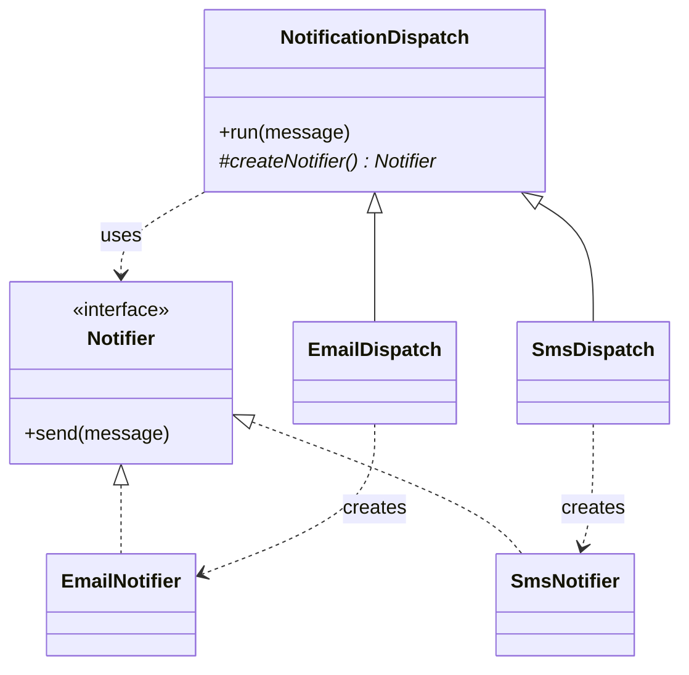

# Factory Method — problem and solution

## Problem and forces

A workflow owns a fixed sequence: validate input, build a payload, send it, record an audit row. Somewhere in that sequence it needs a collaborator that varies — email versus SMS for notifications, CSV versus PDF for file export. Forces collide:

- Keep the workflow text stable so reviewers can trust one path.
- Let each product line introduce its own sender or writer without forking the workflow.
- Keep construction decisions testable without spinning real channels or file systems.

## Naive approach and why it fails

Scatter `new EmailSender()` or `new CsvWriter()` inside the workflow, or grow a giant `switch` on a channel string. Every new channel edits the same method. Tests either hit real infrastructure or copy the switch into fixtures. Coupling spreads: changing construction rules means touching business orchestration.

## Solution

Name a product interface the workflow already understands (`Notifier`, `ExportWriter`). Give the workflow (or a small creator type) a single factory method — `createNotifier()`, `createWriter()` — that returns that interface. Concrete creators override or supply the method and return the matching product. Clients call the workflow; they never name concrete products.

## Analogy (original)

Think of a document editor’s “Share” action. The editor always: gather selection → wrap as a message → deliver → confirm. *How* delivery happens (inbox push, email digest, webhook) is a separate plug. Factory Method is the plug socket on the Share action: the action asks “give me a deliverer,” and each product edition wires a different deliverer into that socket.

## Structure

| Participant | Role |
|-------------|------|
| Product | Contract the workflow depends on (`Notifier`, `ExportWriter`) |
| ConcreteProduct | Real collaborator (`EmailNotifier`, `CsvWriter`) |
| Creator | Declares `createProduct()` and runs the stable workflow |
| ConcreteCreator | Implements `createProduct()` for one product family or edition |

