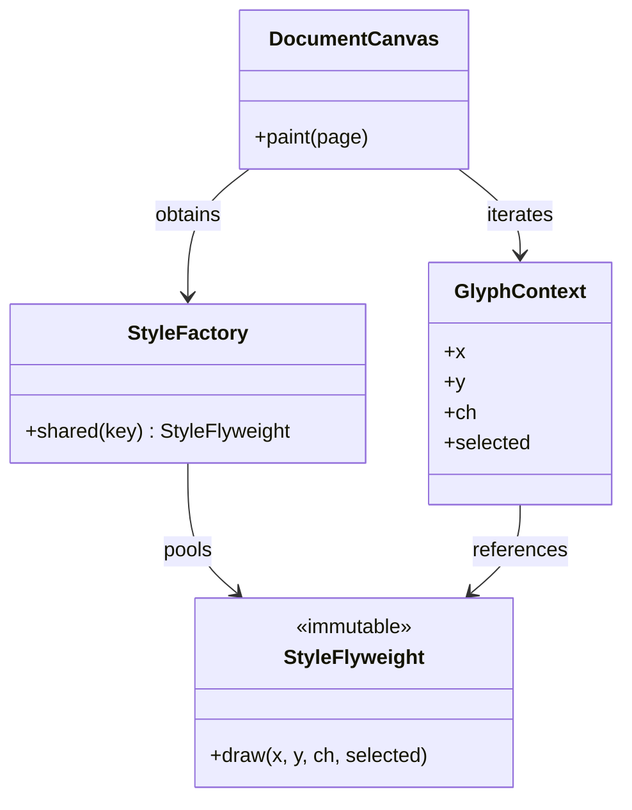

# Flyweight — problem and solution

## Problem and forces

A document editor paints a long outline: each glyph carries font face, weight, size, color token, and kerning table references. A notification renderer stamps the same badge artwork onto thousands of rows. Forces collide:

- Memory must stay bounded when item counts climb into the tens or hundreds of thousands.
- Drawing and layout code still needs per-item coordinates, selection highlights, and locale overlays.
- Intrinsic style data must stay identical and safe to share — no accidental cross-item mutation.

## Naive approach and why it fails

`new Style(...)` (or a fat glyph object) per character or row. The heap fills with duplicate font descriptors and color tables. Profiling shows megabytes of identical blobs. Copying “for safety” makes mutation bugs rarer but wastes even more memory. Caching whole mutable objects without freezing intrinsic fields creates silent cross-talk when one caller mutates a “shared” style.

## Solution

Split state into **intrinsic** (shared, immutable, keyed) and **extrinsic** (passed in at use time: `x`, `y`, selection flag, overlay). A small factory or pool returns the same flyweight instance for a given intrinsic key. Context objects hold extrinsic data plus a reference to the shared flyweight. Operations accept extrinsic arguments; they never store them inside the shared object.

## Analogy (original)

A print shop keeps one rubber stamp per stock phrase (“PAID”, “DRAFT”, “CONFIDENTIAL”). The stamp face is the intrinsic art. When a clerk stamps a form, they choose *where* on the page and *which date* to write beside the imprint — that placement and date are extrinsic. Nobody mills a unique stamp block for every form on the shelf.

## Structure

| Participant | Role |
|-------------|------|
| Flyweight | Holds intrinsic state; accepts extrinsic args in operations |
| FlyweightFactory / pool | Reuses flyweights by intrinsic key |
| Context | Holds extrinsic state and a flyweight reference |
| Client | Supplies extrinsic data at use time; never mutates intrinsic fields |

