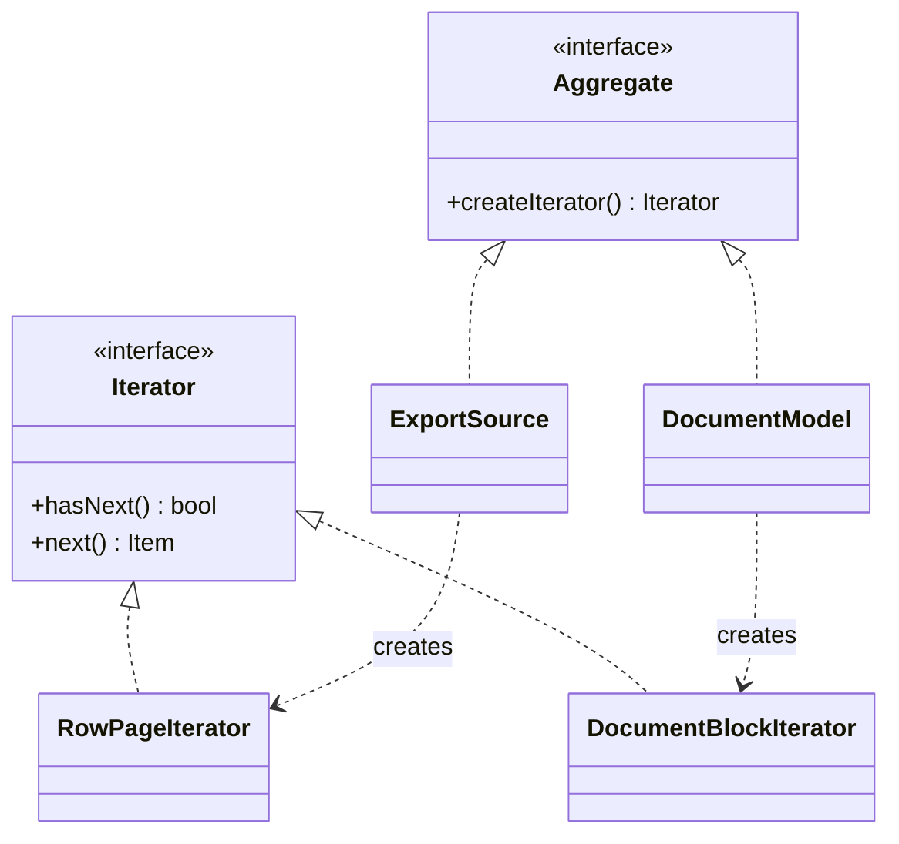

# Iterator — problem and solution

## Problem and forces

A file-export job must walk rows; a cache warmer must walk keys; a document editor must walk blocks. Forces collide:

- Client loops should not hard-code array indexes, SQL cursors, or tree recursion.
- Storage may change (in-memory list → paged query → nested sections) without rewriting exporters.
- Traversal may be lazy — loading every row into RAM is not acceptable.

## Naive approach and why it fails

Pass raw arrays everywhere and use `for (i…)` or reach into private trees with recursive helpers copied into each consumer. Every new collection shape edits every consumer. Encapsulation breaks: exporters know about `blocks[i].children`. Large exports OOM because someone called `->all()` first.

## Solution

Define an Iterator with `hasNext`/`next` (or language-native `Symbol.iterator` / `Iterator`). Collections implement a factory (`createIterator` / `getIterator`) that returns a cursor over their private structure. Clients depend only on the iterator contract. Multiple iterator types can offer different walks (flat, depth-first, filtered) without exposing storage.

## Analogy (original)

A warehouse pick list should not require opening every crate’s lid yourself. You get a handheld scanner that beeps “next SKU” until the route ends. Whether stock sits on shelves, pallets, or overflow cages is the warehouse’s problem — the scanner is the Iterator.

## Structure

| Participant | Role |
|-------------|------|
| Iterator | Cursor API (`next`, `hasNext` / native iterable protocol) |
| ConcreteIterator | Knows position inside one collection implementation |
| Aggregate / Collection | Holds items; creates iterators |
| ConcreteAggregate | Specific store (row page, cache namespace, document tree) |
| Client | Consumes items through the iterator only |

