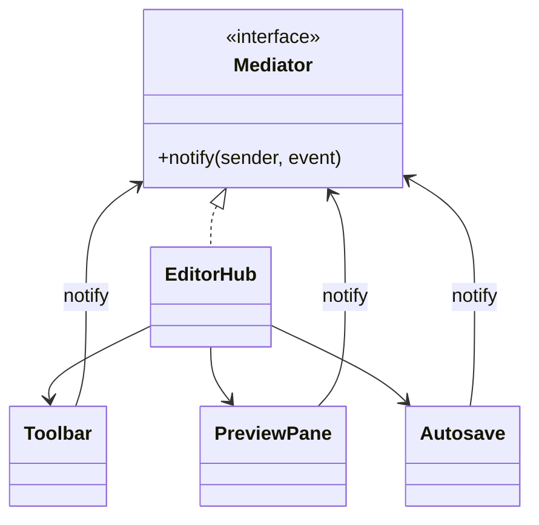

# Mediator — problem and solution

## Problem and forces

A document editor has a toolbar, outline pane, preview, and autosave status. Or a notification subsystem must coordinate email, push, and in-app inbox when a payment succeeds. Forces collide:

- Colleagues must react to each other without each holding references to all peers.
- Interaction rules (when to refresh preview, when to suppress duplicate mail) change more often than colleague internals.
- Tests should fake the hub or one colleague without standing up the whole mesh.

## Naive approach and why it fails

Wire every colleague to every other: toolbar calls preview and outline; outline calls preview and autosave; payment adapter calls three notifiers that call each other for dedupe. The graph becomes N². Adding a cache warm-up step edits five constructors. Cycles appear. Unit tests need the whole clique.

## Solution

Introduce a Mediator that colleagues notify with coarse events (“selection changed,” “payment captured”). The Mediator decides which colleagues to update and in what order. Colleagues know only the Mediator (or a narrow port), not each other. Interaction policy lives in one type.

## Analogy (original)

A live studio control room: camera ops, captioner, and playlist desk never shout cues at each other. Each presses a talkback button to the director’s desk. The director decides who goes live next and who stays muted. The director’s desk is the Mediator — it owns the interaction rules, not the craft of framing or captioning.

## Structure

| Participant | Role |
|-------------|------|
| Mediator | Interface for colleague notifications / routing API |
| ConcreteMediator | Encodes interaction rules; holds colleague references |
| Colleague | UI pane, notifier, export service — talks only via mediator |
| ConcreteColleague | Specific participant that sends/receives through the hub |

