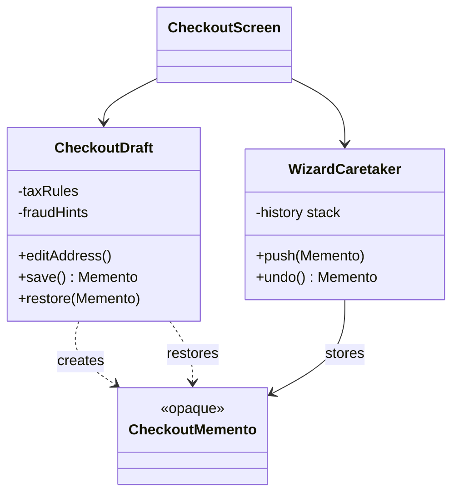

# Memento — problem and solution

## Problem and forces

A multi-step checkout computes tax, discount eligibility, and fraud-score hints inside a `CheckoutDraft` object. The customer may back out of card entry and return to the address step. An export job similarly checkpoints progress so a failed PDF pass can resume without re-reading every source row. Forces:

- Private fields (eligibility rules, partial hashes, cursor offsets) must stay hidden from the UI and job runner.
- Rollback must restore *exactly* the prior internal state — not a guess rebuilt from public props.
- History depth must stay bounded so drafts and jobs do not exhaust memory.

## Naive approach and why it fails

Expose getters for every private field and let the UI deep-copy a DTO. Encapsulation dies; future internal fields require UI updates. Or serialize the whole object to JSON in the controller — caretakers learn secrets, and restore becomes a second public constructor. Or keep a giant undo stack of full clones with no opacity and no depth cap.

## Solution

The **originator** (`CheckoutDraft`, `ExportJob`) creates a **memento**: an opaque token only it can interpret. A **caretaker** (wizard controller, job runner) stores and returns mementos without reading their insides. Restore asks the originator to rehydrate from the token. Narrow the memento’s public API to nothing useful for outsiders (or use language features that hide fields).

## Analogy (original)

A hotel front desk keeps guest folio adjustments in a sealed pouch clipped to the room key sleeve. Night auditors may stack pouches chronologically when a guest disputes a charge, but they do not open them — only the property management system that sealed the pouch can unfold it and restore the folio line. The pouch is the memento; the desk drawer is the caretaker.

## Structure

| Participant | Role |
|-------------|------|
| Originator | Creates/restores mementos from private state |
| Memento | Opaque snapshot; narrow or empty public API |
| Caretaker | Stores history; never inspects memento contents |
| Client | Asks caretaker to undo/redo; talks to originator for edits |

