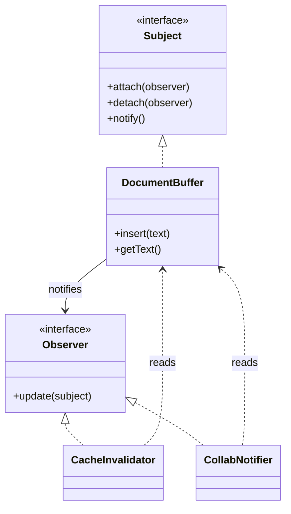

# Observer — problem and solution

## Problem and forces

A core object changes — a document buffer after an edit, a cache entry after a write, a payment status after capture. Several reactions must run: refresh a preview pane, drop related cache keys, send a notification. Forces collide:

- Keep the core object focused on its own state rules.
- Allow new reactions without opening and editing the core object.
- Keep reactions independently testable and removable.

## Naive approach and why it fails

Hard-code every reaction inside the mutator: `save()` calls `preview.refresh()`, `cache.forget(...)`, `mailer.notify(...)`. Each new reaction edits the same method. Tests pull in every side effect. Optional reactions require flags inside the core path. Coupling becomes a permanent fan-out list owned by the wrong type.

## Solution

Give the subject a small subscription API (`attach` / `detach` / `notify`, or framework equivalents). Observers implement a narrow update hook. When state that matters changes, the subject notifies attached observers; each observer decides what to do. The subject never imports concrete reaction classes.

## Analogy (original)

In a document editor, the text buffer is the subject. The outline pane, the dirty-flag indicator, and a “notify collaborators” hook are observers. Typing updates the buffer once; interested panes subscribe and refresh themselves. The buffer does not know the outline’s layout code.

## Structure

| Participant | Role |
|-------------|------|
| Subject | Holds attach/detach/notify; owns the interesting state |
| Observer | Narrow update interface |
| ConcreteSubject | Stores state; notifies after change |
| ConcreteObserver | Reacts (cache invalidation, notification, UI refresh) |

