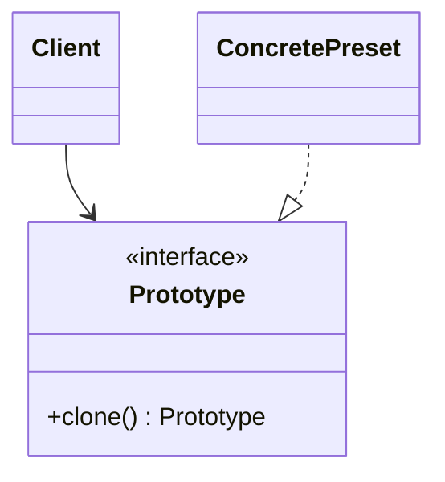

# Prototype — problem and solution

## Problem and forces

File-export templates and notification digests often start from a rich base configuration. Callers that re-enter every field couple to concrete classes and cannot copy private caches inside the instance.

## Naive approach and why it fails

Serialize to JSON and parse again, or expose setters for every field. Fails on private state, functions, and identity-sensitive resources.

## Solution

Declare a clone operation on the product contract. Each concrete type copies itself (and decides shallow vs deep rules). Optional registry holds named prototypes for common presets.

## Analogy (original)

A print shop keeps one calibrated press setup sheet. New jobs photocopy that sheet and tweak ink density — they do not rebuild calibration from blank paper each time.

## Structure

| Participant | Role |
|-------------|------|
| Prototype | Declares clone() |
| ConcretePrototype | Implements clone for its fields |
| Client | Asks for copies without knowing the class |
| Registry (optional) | Named catalog of ready prototypes |

