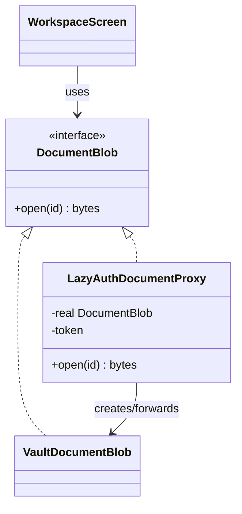

# Proxy — problem and solution

## Problem and forces

A document workspace offers “Open attachment.” Opening the real binary store spins a network client, decrypts a vault handle, and allocates buffers. Most list views never open anything. Elsewhere, a payment adapter must refuse charges unless the caller passed an authorization token. Forces:

- Callers should keep talking to one stable interface (`DocumentBlob`, `PaymentPort`).
- Real construction and remote I/O should wait until needed.
- Access control and audit must happen *before* the real subject runs — not scattered in every screen.

## Naive approach and why it fails

Construct the real subject in every controller, or sprinkle `if (!authorized) return` beside every call. Lazy-loading becomes copy-pasted null checks. Authz drifts between call sites. Tests either boot real vaults or miss the gate. Changing the access rule means hunting every `open()` / `charge()`.

## Solution

Introduce a **proxy** that implements the same subject interface. Callers depend only on that interface. The proxy decides when to create or reach the real subject, may enforce authz/caching/logging, then forwards. Virtual (lazy), protection, remote, and smart-reference variants differ in *why* they intercept — not in the shape.

## Analogy (original)

A research archive keeps rare film reels in a climate vault. Readers never walk into the vault. They hand a request slip to a clerk at the counter. The clerk checks the badge, logs the pull, and only then walks the aisle to fetch the reel. The clerk is the proxy: same “give me reel X” conversation as the vault itself, with access and laziness in between.

## Structure

| Participant | Role |
|-------------|------|
| Subject | Shared interface (`DocumentBlob`, `PaymentPort`) |
| RealSubject | Expensive or remote implementation |
| Proxy | Same interface; controls access / lifetime / forwarding |
| Client | Depends on Subject; unaware which concrete runs |

