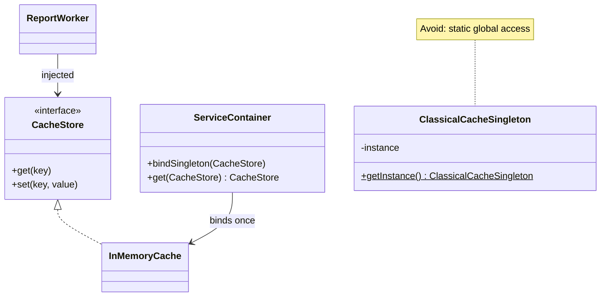

# Singleton — problem and solution

## Problem and forces

Some collaborators are expensive or must coordinate process-wide state: an in-memory cache façade, a connection pool wrapper, a feature-flag snapshot. Forces:

- Call sites want a short path to “the” instance.
- Accidental second instances would duplicate connections or diverge cache views.
- **Counter-force (dominant today):** tests, multi-tenant apps, and frameworks already provide controlled single-instance binding without global statics.

## Naive approach and why it fails

`Cache::getInstance()` / static `$instance` with private constructors. Every module reaches into the global. Tests cannot isolate; parallel requests share mutable state; lifetimes are “until process death.” Hidden coupling makes refactors scary. In PHP, static Singletons also interact badly with long-running workers if state is not reset.

## Solution (classical)

Restrict construction, keep one static instance, expose `getInstance()`. **Solution preferred in this kit:** do **not** use classical Singleton. Bind the class **once** in the framework container (or bootstrap) and **inject** it. If you must document classical Singleton for literacy or legacy removal, treat `getInstance()` as a debt seam to delete.

## Analogy (original)

A cache store is like a single shared whiteboard in a control room. You do need one whiteboard for that room — but you do not give every hallway a magical portal that summons “the” whiteboard by shouting its name. You put the whiteboard in the room (composition root) and hand people a marker (injection). Classical Singleton is the magical portal; the container is the room.

## Structure

| Participant | Role |
|-------------|------|
| Singleton (classical) | Private ctor; static `getInstance()` |
| Client | Calls `getInstance()` (undesirable coupling) |
| Preferred: Container | Binds one instance; injects into clients |
| Preferred: Client | Depends on interface via constructor |

