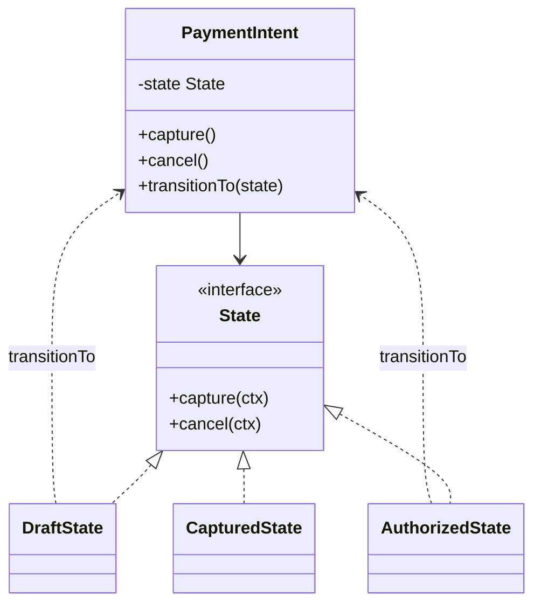

# State — problem and solution

## Problem and forces

An object has a lifecycle: a payment may be `draft`, `authorized`, `captured`, or `failed`; a document may be `editing`, `review`, or `locked`. The same method names (`submit`, `cancel`, `export`) must obey different rules per mode. Forces collide:

- Keep invalid transitions impossible or loudly rejected.
- Avoid one class that grows a combinatorial `switch` on mode.
- Make each mode’s rules reviewable in isolation.

## Naive approach and why it fails

Store a string/enum `status` and branch in every method: `if status === "captured" throw`. Every new status edits every method. Invalid transitions hide in missing `else` arms. Tests must cover the full cross-product inside one class.

## Solution

Introduce a `State` interface with the operations the context exposes. Each concrete state implements those operations for one mode and may ask the context to move to another state. The context holds the current state object and forwards calls. Behavior appears to change class when the state object is replaced.

## Analogy (original)

A payment-provider adapter wraps a charge that moves through authorization modes. While `authorized`, `capture()` talks to the provider; while `draft`, `capture()` is rejected; while `captured`, `capture()` is idempotent no-op. Each mode is a small object the adapter swaps in — not a longer `switch` inside one god method.

## Structure

| Participant | Role |
|-------------|------|
| Context | Public API; holds current state; may expose `transitionTo` |
| State | Interface for mode-specific operations |
| ConcreteState | Rules + allowed transitions for one mode |

