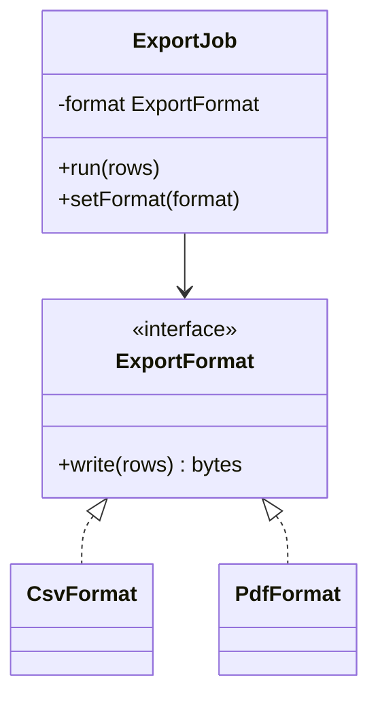

# Strategy — problem and solution

## Problem and forces

An exporter, cache, or checkout flow must run *an* algorithm that varies: file export as CSV or PDF; cache eviction by LRU or TTL; charge via provider A or B behind one payment port. Forces collide:

- Keep orchestration (validate → run → audit) stable.
- Add a new algorithm without editing that orchestration.
- Select the algorithm from config, tenant, or caller preference.

## Naive approach and why it fails

Embed `if format === "pdf"` / `switch (provider)` inside the exporter or checkout. Every new format or provider edits the same method. Tests drag every branch. Shared setup code duplicates across arms.

## Solution

Define a strategy interface for the varying step (`ExportFormat.write`, `EvictionPolicy.selectKey`, `PaymentProvider.charge`). The context holds one strategy and delegates. Composition root or caller supplies the concrete strategy. Algorithms stay interchangeable; clients depend only on the interface.

## Analogy (original)

A file-export job always: gather rows → transform → write bytes → store. Writing bytes is the strategy: CSV writer, PDF writer, or spreadsheet writer. The job never opens a `switch` on format; it asks the current writer to emit.

## Structure

| Participant | Role |
|-------------|------|
| Strategy | Common algorithm contract |
| ConcreteStrategy | One algorithm implementation |
| Context | Holds a strategy; runs the stable flow |

