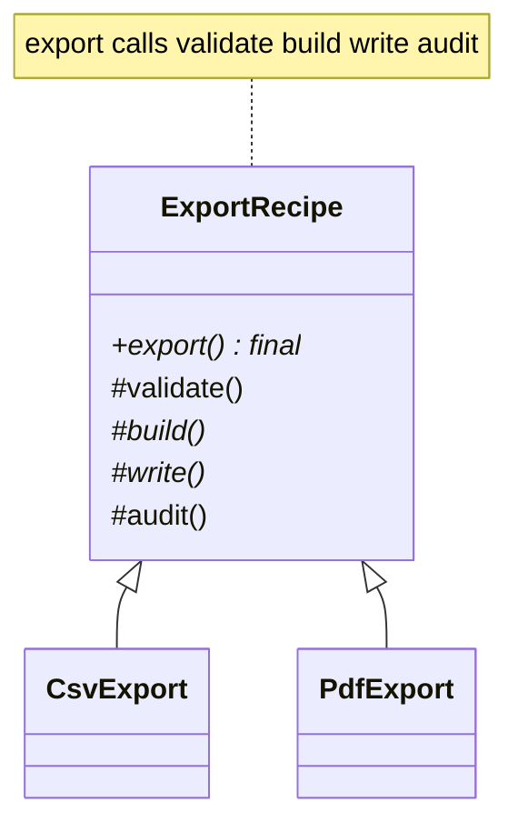

# Template Method — problem and solution

## Problem and forces

Multiple exporters or notifiers share a ritual: authorize → gather → transform → deliver → audit. Most steps are identical; a few differ (how to transform, how to deliver). Forces collide:

- Keep the ritual order and mandatory steps impossible to skip.
- Allow variants without copy-pasting the ritual.
- Avoid letting subclasses reorder or drop compliance steps.

## Naive approach and why it fails

Copy the whole ritual into `CsvExport` and `PdfExport`, or pass boolean flags through one mega-method. Order drifts between copies. A forgotten audit in one variant becomes a compliance bug. Flags explode into nested conditionals.

## Solution

Put the ritual in a final (or well-guarded) template method on a base type. Declare protected hooks / abstract steps for the variable parts. Concrete classes implement only those steps. The template method calls hooks in the fixed order.

## Analogy (original)

HTTP middleware stacks fix *when* cross-cutting work runs around a handler. Template Method is the same idea inside one inheritance line: the base `export()` always runs validate → build → write → audit; subclasses only supply `build()` and `write()`. The order is not negotiable.

## Structure

| Participant | Role |
|-------------|------|
| AbstractClass | Defines `templateMethod()` and abstract/hook steps |
| ConcreteClass | Implements the deferred steps |

