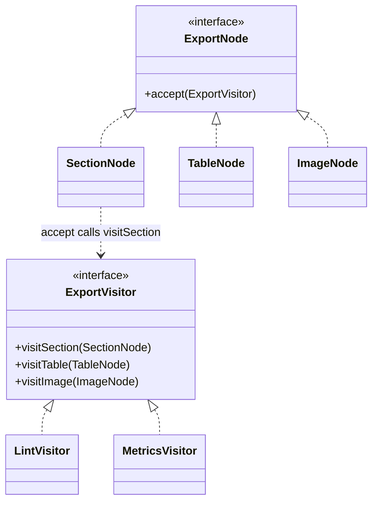

# Visitor — problem and solution

## Problem and forces

An export pipeline builds a stable tree: `SectionNode`, `TableNode`, `ImageNode`. Product asks for lint, word-count metrics, PDF serialize, and an accessibility scan — each quarter adds another pass. Forces:

- Element classes should not accumulate dependencies on every new tool (PDF SDK, a11y rules, metrics stores).
- Each operation needs typed behavior per node kind — not one generic “handle any node” blob.
- Adding a *new operation* should avoid editing every node class; adding a *new node kind* is rare and accepted as costly.

## Naive approach and why it fails

Stuff `lint()`, `metrics()`, `toPdf()`, `a11y()` onto every node. Classes bloat; unrelated SDKs leak into the domain model. Or grow a central `switch (node.type)` module that every operation edits — merge conflicts and missed cases. Or reflection-based “handlers” that fail silently when a new type appears.

## Solution

Give elements a single `accept(Visitor)` that calls back `visitor.visitSection(this)` / `visitTable(this)` / …. Each **visitor** implements one operation across all element types. New operations become new visitor classes. The structure’s `accept` methods stay small and stable.

## Analogy (original)

A freight terminal parks sealed crates of fixed shapes (tube, flat pallet, refrigerated box). Different inspectors walk the same yard with different clipboards: weight audit, temperature compliance, customs tariff. Each crate type only knows how to open its latch for an inspector (`accept`); the clipboard (visitor) carries the procedure. New clipboards appear often; new crate shapes almost never do.

## Structure

| Participant | Role |
|-------------|------|
| Visitor | Declares `visitX` for each element type |
| ConcreteVisitor | One operation (lint, metrics, serialize) |
| Element | Declares `accept(Visitor)` |
| ConcreteElement | Implements `accept` by calling the matching `visit*` |
| ObjectStructure | Document/export tree that enumerates elements |

