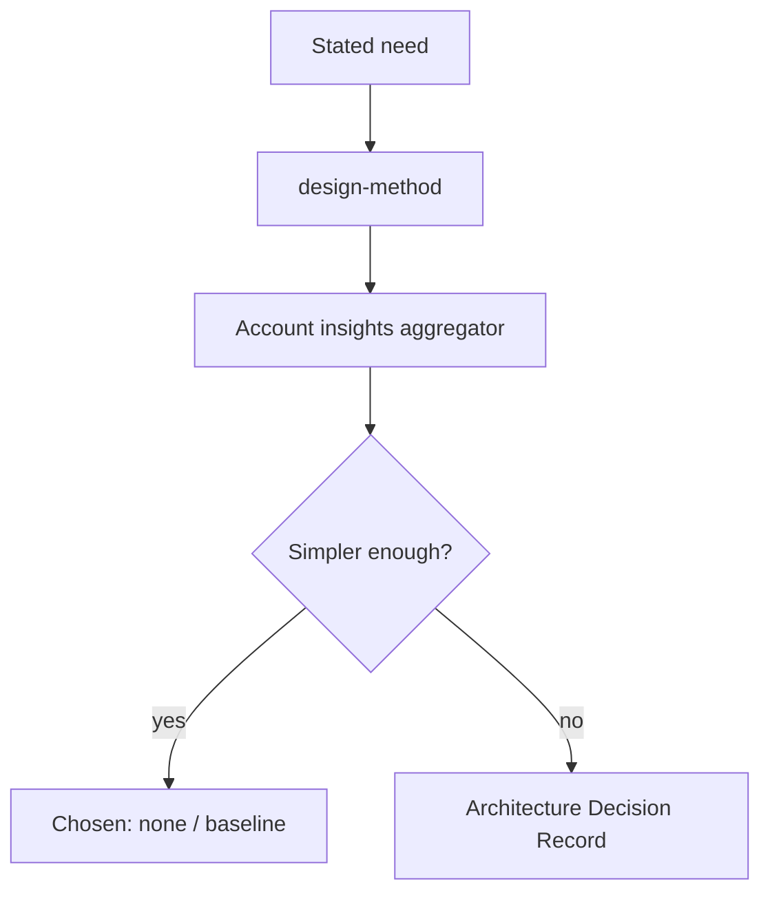

# Account insights aggregator — problem and solution

## Problem and forces

Users connect institutions; data arrives async; categorization and budgets need freshness without blocking UX.

Forces typically include latency SLOs, consistency needs, cost, operability, and team skill.

## Naive approach and why it fails

- Sync scrape on every page load
- Store bank passwords in app DB

## Solution

OAuth/partner APIs; encrypted tokens; webhook/queue ingest; categorize async; read models for dashboards; never store raw credentials; strong authz per user.

## Analogy (original)

Accountant who receives statements by mail and files them — not one who asks for your bank password daily.

## Structure

