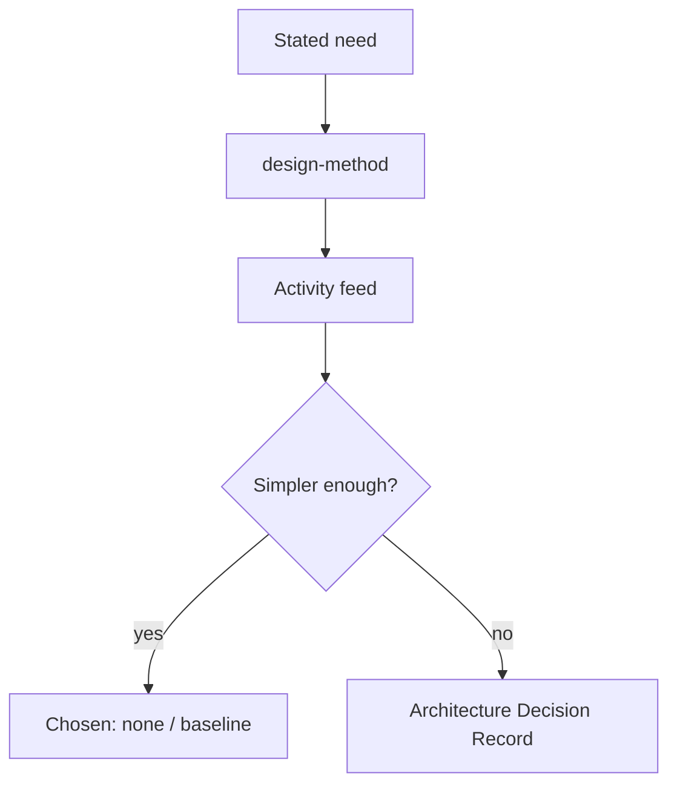

# Activity feed — problem and solution

## Problem and forces

Users post; followers need a timely feed; celebrity fan-out explodes write amplification.

Forces typically include latency SLOs, consistency needs, cost, operability, and team skill.

## Naive approach and why it fails

- On every read, query all followees' posts
- Fan-out to millions sync

## Solution

Hybrid fan-out: push for normal users, pull for celebrities; timeline cache; eventual consistency OK; search as separate index. Back-of-envelope follow graph size.

## Analogy (original)

Newspaper delivery for most homes; celebrities print on demand at the kiosk.

## Structure

