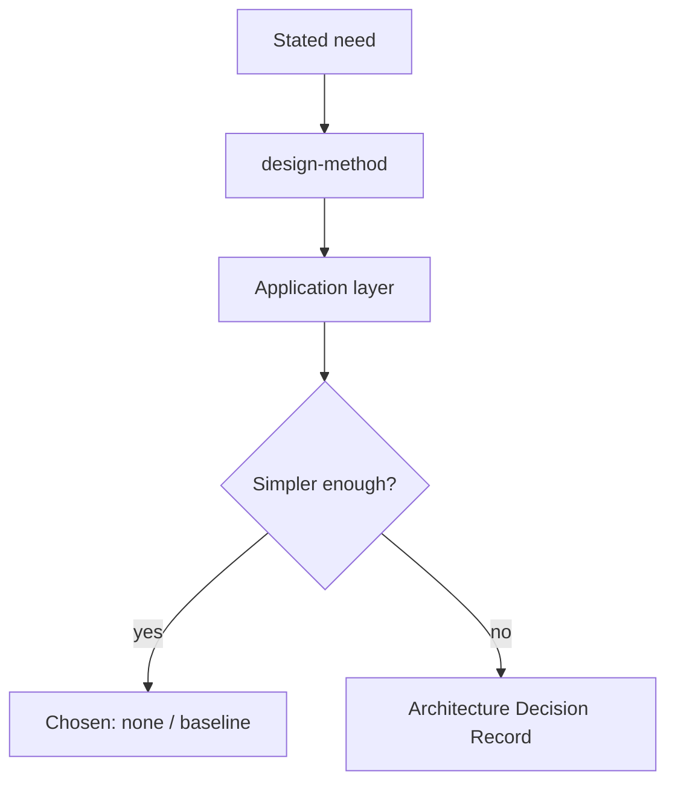

# Application layer — problem and solution

## Problem and forces

Distributed monoliths appear when services are cut by fashion, not by change boundaries.

Forces typically include latency SLOs, consistency needs, cost, operability, and team skill.

## Naive approach and why it fails

- Microservices on day one
- One giant process forever with no modules

## Solution

Prefer modular monolith until team/scale forces. If services: clear APIs, discovery, independent deploy, no shared DB as integration. Service discovery via DNS/platform — not ad-hoc IPs.

## Analogy (original)

Open-plan office with clear teams vs cubicle maze with no doors.

## Structure

