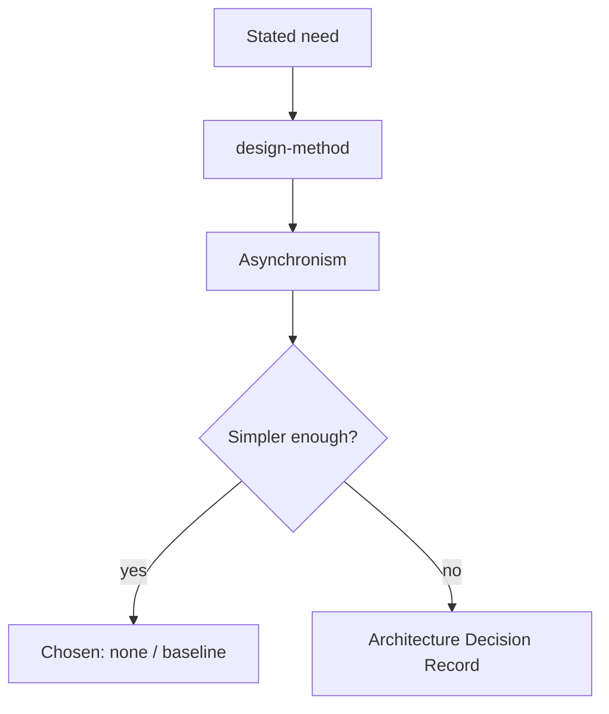

# Asynchronism — problem and solution

## Problem and forces

Sync pipelines timeout under load; users wait on email/PDF/AI.

Forces typically include latency SLOs, consistency needs, cost, operability, and team skill.

## Naive approach and why it fails

- Everything sync
- Fire-and-forget with no durability

## Solution

Queue durable work; return quickly; process with workers; make consumers idempotent. Prefer platform queues. Pair architecture-patterns queue-based-load-leveling / competing-consumers.

## Analogy (original)

Coat check: drop the bag, get a ticket, pick up later.

## Structure

