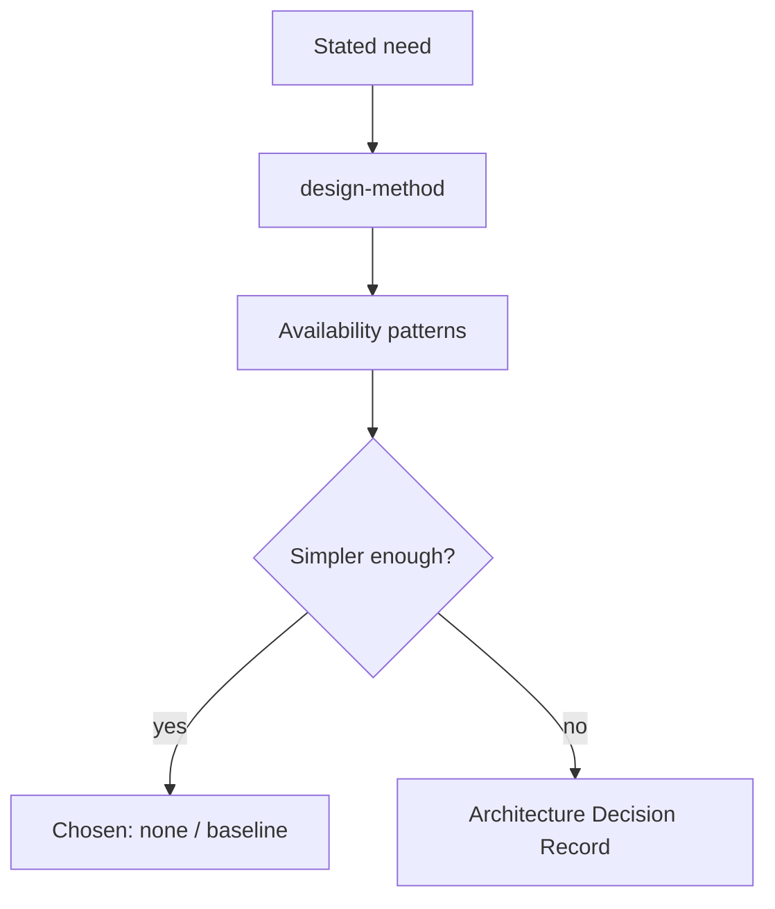

# Availability patterns — problem and solution

## Problem and forces

Single instances and manual failover turn disk failure into user-visible downtime.

Forces typically include latency SLOs, consistency needs, cost, operability, and team skill.

## Naive approach and why it fails

- One box
- Active/passive with untested failover

## Solution

Replicate data; automate failover; rehearse. Understand serial vs parallel dependency math for availability %. Prefer health probes + load balancer over hope.

## Analogy (original)

Backup generator that is tested monthly — not a dusty promise.

## Structure

