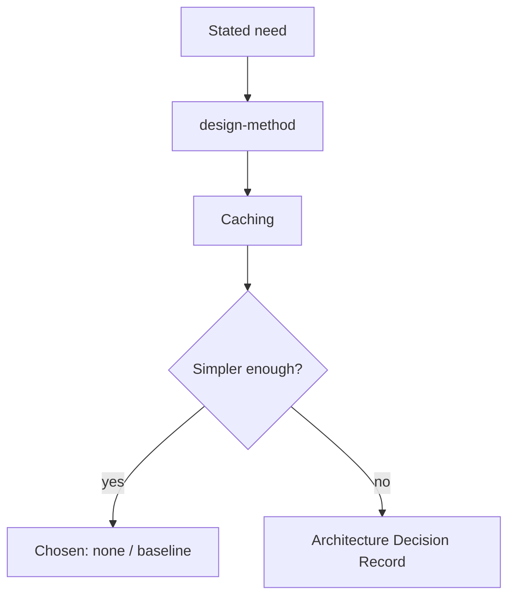

# Caching — problem and solution

## Problem and forces

Uncached hot reads melt the DB; poorly invalidated caches serve lies.

Forces typically include latency SLOs, consistency needs, cost, operability, and team skill.

## Naive approach and why it fails

- Cache everything forever
- No TTL/invalidation story

## Solution

Choose layer by data volatility. Prefer cache-aside for app data; CDN for static. Document stampede control. Link architecture-patterns cache-aside / materialized-view when relevant.

## Analogy (original)

Sticky notes on your monitor for facts you reuse — rewrite when the source changes.

## Structure

