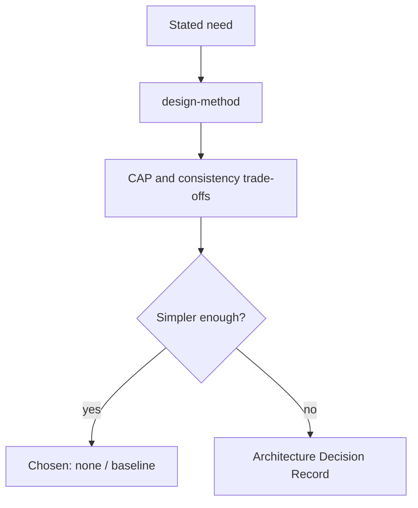

# CAP and consistency trade-offs — problem and solution

## Problem and forces

Marketing claims of 'always consistent and always available' across regions hide partitions and lag.

Forces typically include latency SLOs, consistency needs, cost, operability, and team skill.

## Naive approach and why it fails

- Ignore partitions
- Strong consistency everywhere including multi-region reads

## Solution

Name the partition scenario. Prefer CP or AP for that surface. Document client-visible lag for AP/eventual systems. Pair with consistency-models pack.

## Analogy (original)

Two island warehouses during a storm: either wait for agreement (consistency) or sell with possible mismatch (availability).

## Structure

