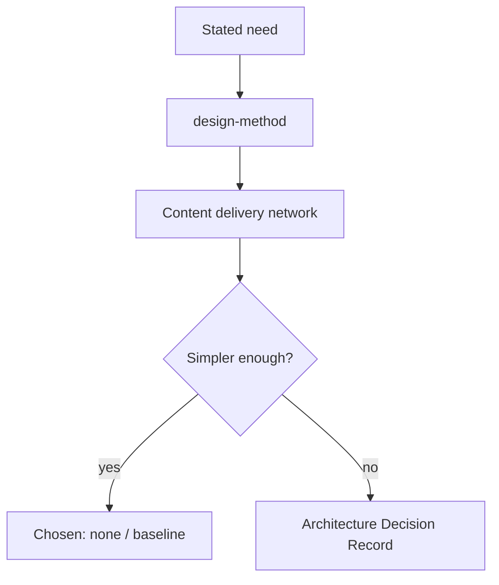

# Content delivery network — problem and solution

## Problem and forces

Origin servers burn bandwidth and latency on immutable assets.

Forces typically include latency SLOs, consistency needs, cost, operability, and team skill.

## Naive approach and why it fails

- Serve /static from app pods only
- No cache headers

## Solution

Push or pull CDN in front of object storage/origin; set cache-control; invalidate on deploy; keep secrets off the CDN.

## Analogy (original)

Neighborhood newsstands instead of one distant printing press for every paper.

## Structure

