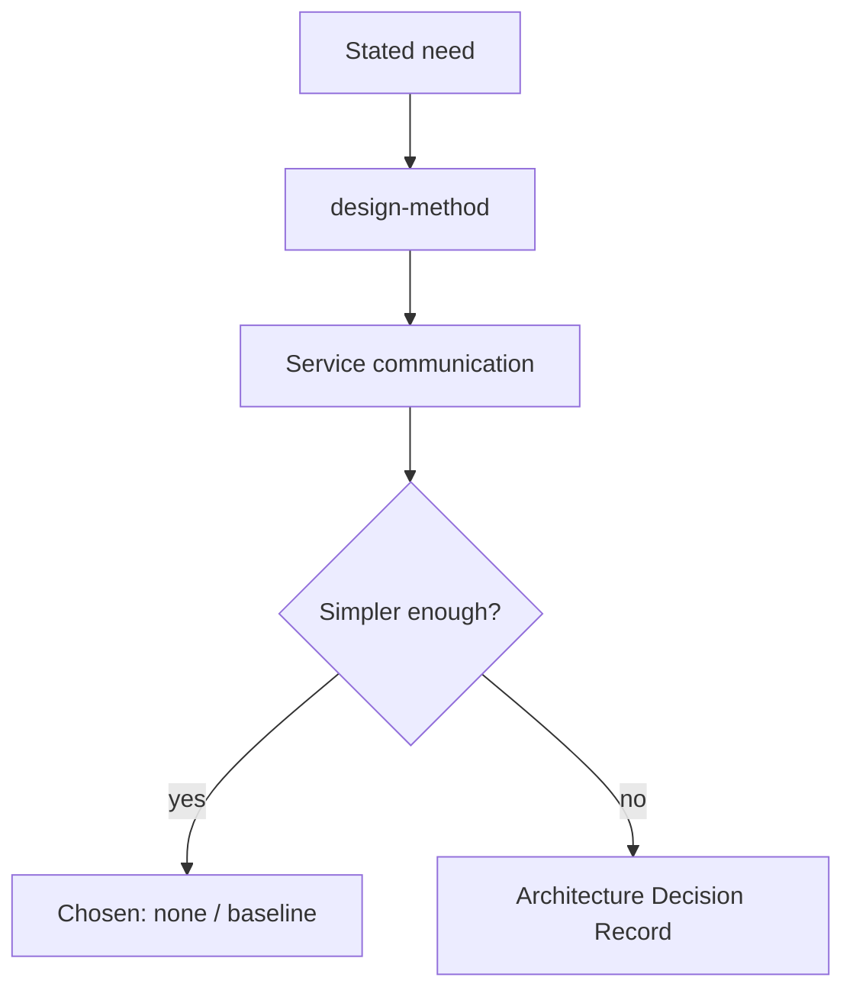

# Service communication — problem and solution

## Problem and forces

Chatty sync RPC meshes create latency and failure cascades; wrong protocol adds overhead.

Forces typically include latency SLOs, consistency needs, cost, operability, and team skill.

## Naive approach and why it fails

- HTTP for huge binary streams without care
- Custom TCP everywhere

## Solution

Default HTTP/JSON or gRPC within the platform; use messaging for fan-out and decoupling. Know TCP vs UDP only when building protocols. Prefer idempotent APIs.

## Analogy (original)

Phone call (sync) vs voicemail/mail (async) — different conversations.

## Structure

