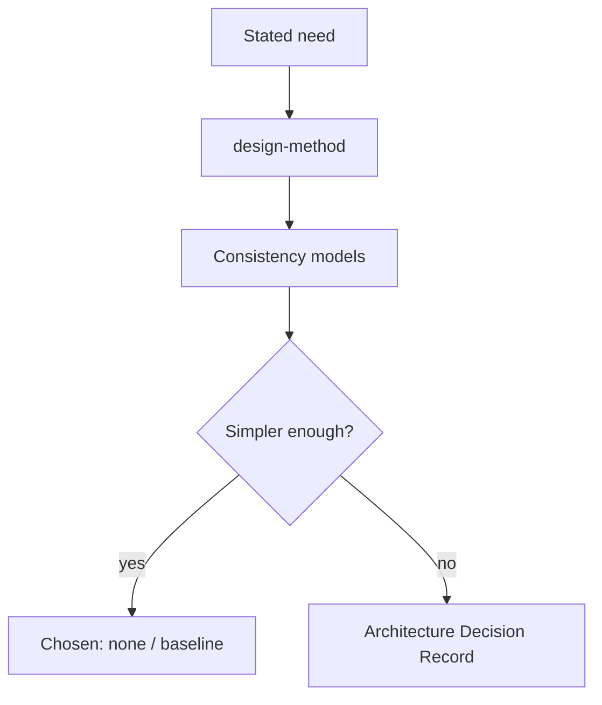

# Consistency models — problem and solution

## Problem and forces

Defaulting to strong consistency kills latency/availability; defaulting to eventual corrupts money/inventory.

Forces typically include latency SLOs, consistency needs, cost, operability, and team skill.

## Naive approach and why it fails

- Eventual for everything
- Serializable for everything

## Solution

Map each read path: money/inventory → strong or carefully fenced; feeds/counters → eventual OK with repair. State read-your-writes where needed.

## Analogy (original)

Bank ledger vs like-count on a post — different correctness bars.

## Structure

