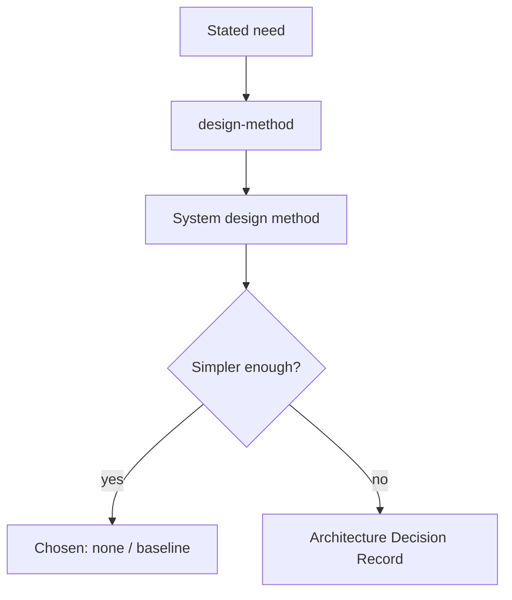

# System design method — problem and solution

## Problem and forces

Teams jump to microservices or a favorite database without stating load, writes, or failure modes.

Forces typically include latency SLOs, consistency needs, cost, operability, and team skill.

## Naive approach and why it fails

- Draw boxes from a blog post
- Skip numbers until production burns

## Solution

Outline use cases, constraints, and assumptions; sketch the high-level design; detail core components; then scale (cache, shard, queue, multi-AZ). Always do back-of-the-envelope QPS, storage, and bandwidth before buying complexity.

## Analogy (original)

Architect a stadium: seats and exits first, then gates and concessions — not souvenir shops before knowing attendance.

## Structure

