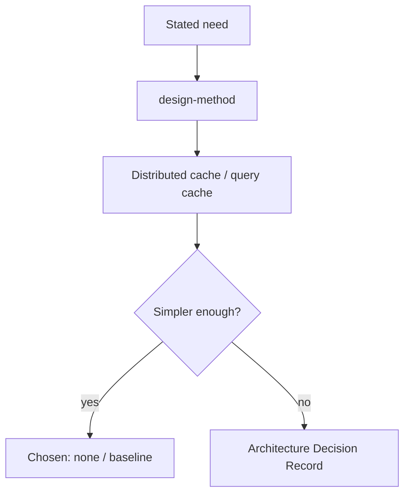

# Distributed cache / query cache — problem and solution

## Problem and forces

Many app nodes hammer origin for identical queries.

Forces typically include latency SLOs, consistency needs, cost, operability, and team skill.

## Naive approach and why it fails

- Local memory only
- No TTL

## Solution

Clustered cache (Redis-style); key design; TTL + invalidation; singleflight/locks on miss; optional read-through; monitor hit rate.

## Analogy (original)

Shared office whiteboard for answers everyone keeps asking.

## Structure

