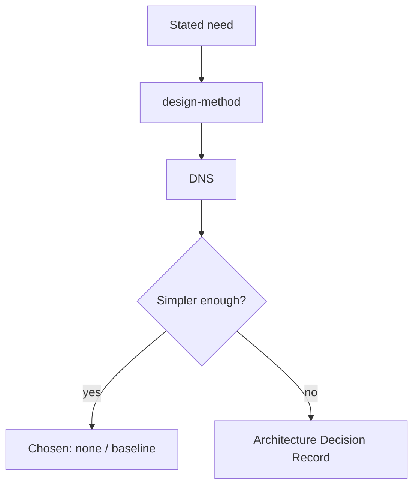

# DNS — problem and solution

## Problem and forces

Hard-coded IPs and tiny TTLs fight change; huge TTLs slow failover.

Forces typically include latency SLOs, consistency needs, cost, operability, and team skill.

## Naive approach and why it fails

- Skip DNS strategy
- TTL of 0 everywhere

## Solution

Name services with DNS; choose TTL for change vs cache; use health-aware routing when the platform offers it; understand recursive resolvers and cache poisoning basics.

## Analogy (original)

Phone book for the internet — stale pages mean wrong numbers.

## Structure

