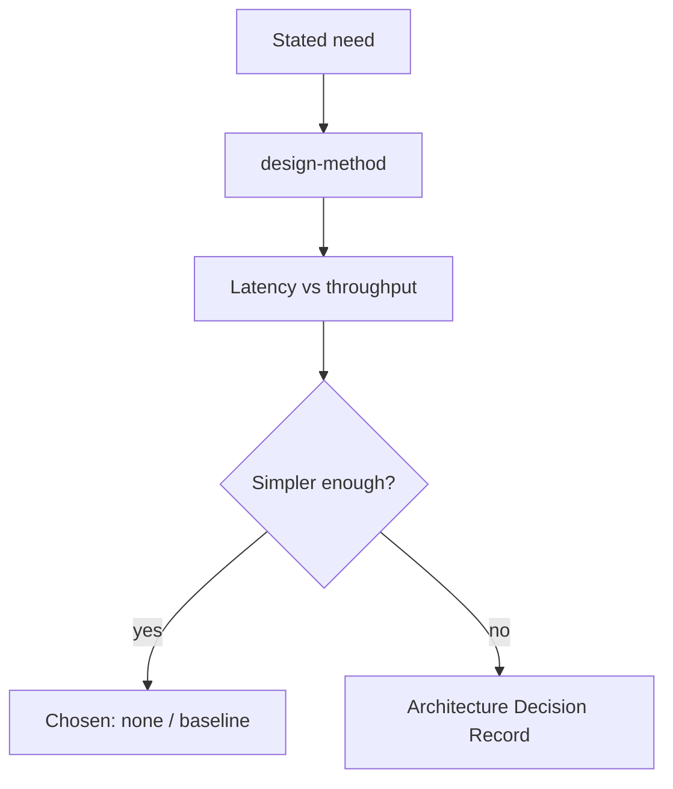

# Latency vs throughput — problem and solution

## Problem and forces

Batching or queues raise throughput but hurt latency; chatty APIs do the opposite.

Forces typically include latency SLOs, consistency needs, cost, operability, and team skill.

## Naive approach and why it fails

- Maximize throughput only
- Minimize every latency without capacity

## Solution

State SLOs for both. Use queues/batching when lag is acceptable; keep sync paths short for user-facing latency. Measure p50/p95/p99 separately from QPS.

## Analogy (original)

Checkout line: one person's wait (latency) vs customers per hour (throughput).

## Structure

