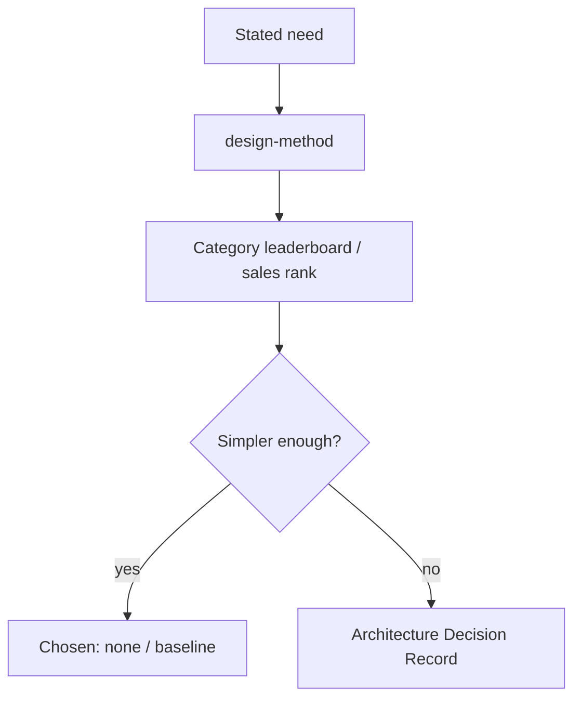

# Category leaderboard / sales rank — problem and solution

## Problem and forces

Ranking millions of items per category with frequent score updates.

Forces typically include latency SLOs, consistency needs, cost, operability, and team skill.

## Naive approach and why it fails

- ORDER BY score on every read

## Solution

Sorted sets / ranking structures per category; async aggregation; approximate ranks when OK; shard categories; cache top-N.

## Analogy (original)

Tournament brackets updated after each match — not a full resort of every player each second.

## Structure

