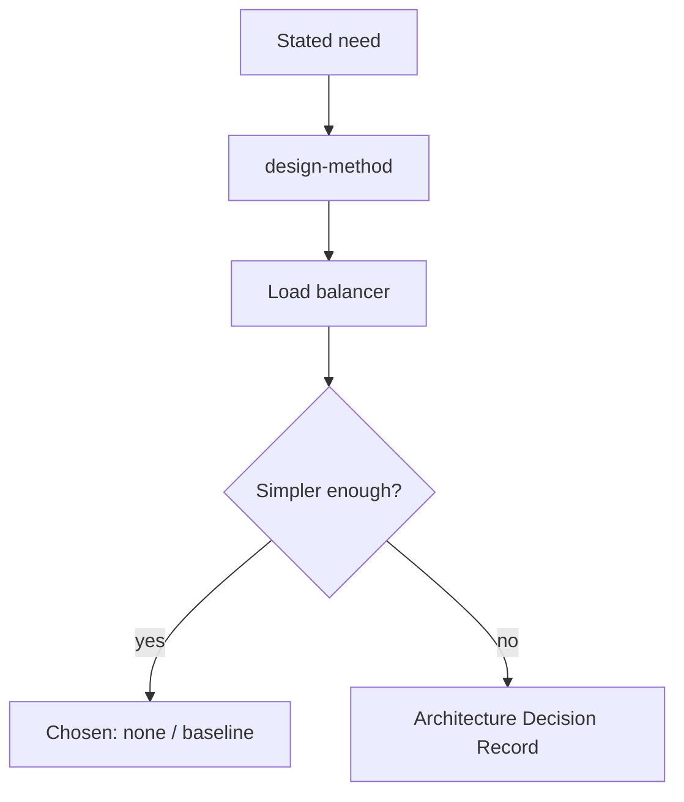

# Load balancer — problem and solution

## Problem and forces

Clients hitting one app host create hot spots and single points of failure.

Forces typically include latency SLOs, consistency needs, cost, operability, and team skill.

## Naive approach and why it fails

- DNS round-robin only
- No health checks

## Solution

Put L4 or L7 LB in front; configure health checks; scale horizontally; offload TLS when appropriate. Know sticky sessions are a smell for stateless apps.

## Analogy (original)

Airport security lines opening more lanes when queues grow.

## Structure

