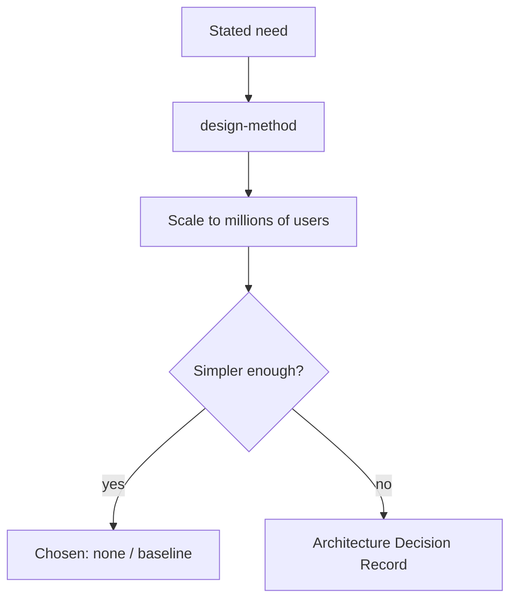

# Scale to millions of users — problem and solution

## Problem and forces

Design must evolve from single box to multi-tier without rewriting the product each time.

Forces typically include latency SLOs, consistency needs, cost, operability, and team skill.

## Naive approach and why it fails

- Start with multi-region active-active
- Skip observability

## Solution

Layer: DNS → CDN/LB → app tier → cache → primary DB + replicas → queues → object storage. Add multi-AZ first; multi-region when latency/DR requires. Measure at each step (design-method).

## Analogy (original)

Growing a shop: stall → store → warehouse → regional warehouses — not a continent franchise on day one.

## Structure

