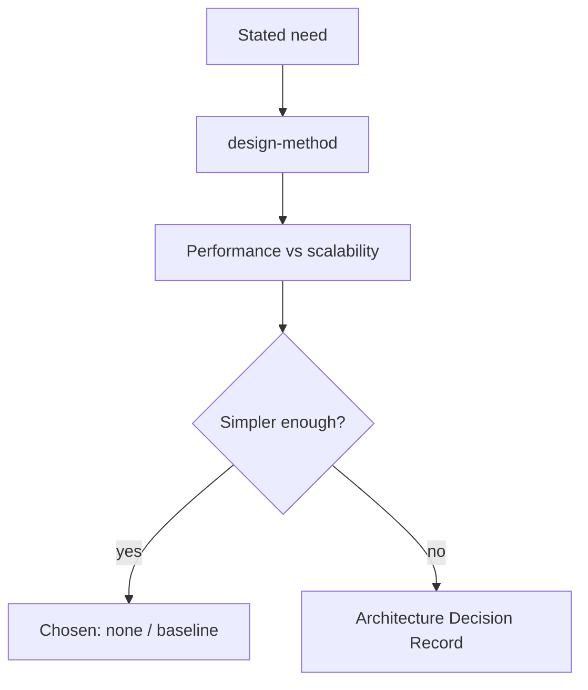

# Performance vs scalability — problem and solution

## Problem and forces

People optimize a single request path when the real pain is concurrent growth — or scale out before fixing algorithmic waste.

Forces typically include latency SLOs, consistency needs, cost, operability, and team skill.

## Naive approach and why it fails

- Always add servers
- Always micro-optimize hot loops first without measuring

## Solution

Performance = work per request/resource. Scalability = ability to grow capacity. Fix O(n²) and N+1 before horizontal sprawl; scale out when a single node is correctly busy.

## Analogy (original)

A faster car (performance) vs more lanes (scalability).

## Structure

