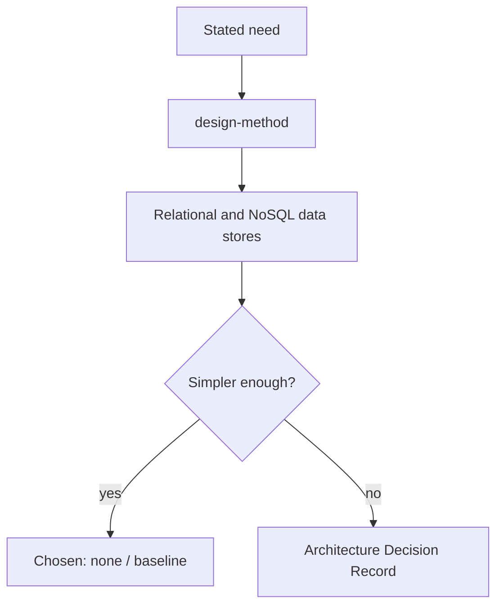

# Relational and NoSQL data stores — problem and solution

## Problem and forces

Default NoSQL loses joins/transactions; default single SQL vertical-scales forever until it cannot.

Forces typically include latency SLOs, consistency needs, cost, operability, and team skill.

## Naive approach and why it fails

- NoSQL because web-scale
- One Postgres forever without read strategy

## Solution

RDBMS for relational integrity and complex queries; document/KV/column/graph when access patterns fit. Federation, replication, sharding are SQL scale tools — earn each. Prefer SQL until a measured reason.

## Analogy (original)

Spreadsheets with formulas (relations) vs labeled boxes (documents) — pick by the job.

## Structure

