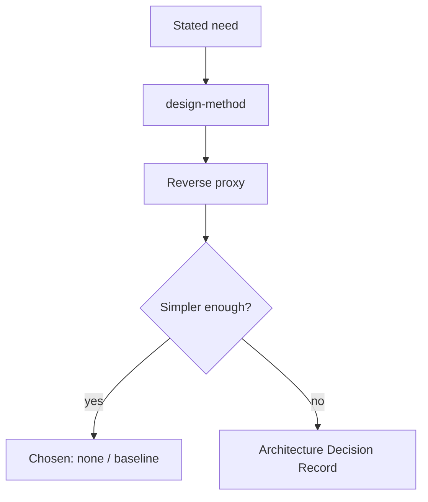

# Reverse proxy — problem and solution

## Problem and forces

App processes handle TLS, compression, and static files poorly under load.

Forces typically include latency SLOs, consistency needs, cost, operability, and team skill.

## Naive approach and why it fails

- Expose app servers directly to the internet

## Solution

Nginx/Caddy/Envoy/API gateway as reverse proxy; compare with load balancer (LB focuses on distribution; reverse proxy on request handling features). Often one product does both.

## Analogy (original)

Reception desk that greets visitors and calls the right office.

## Structure

