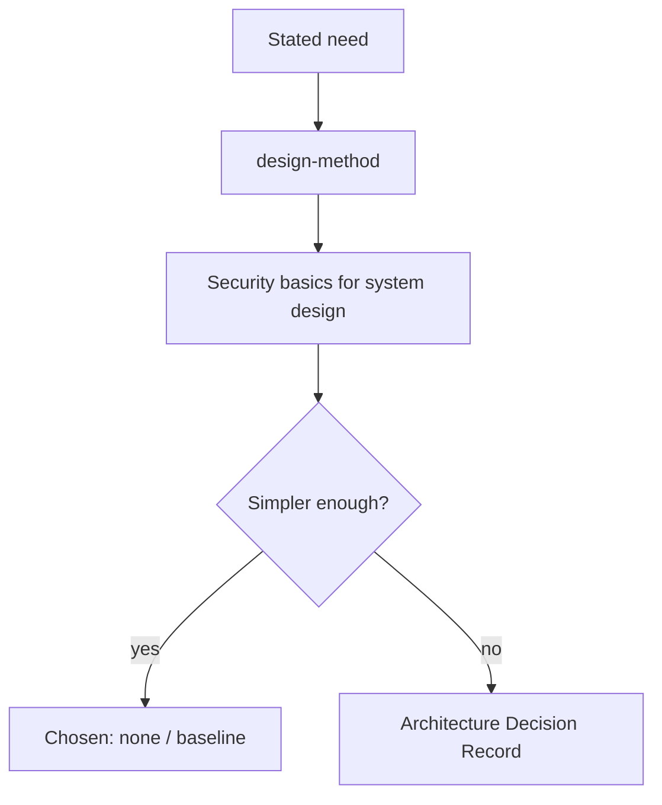

# Security basics for system design — problem and solution

## Problem and forces

Designs that ignore trust boundaries ship open admin routes and plain-text secrets.

Forces typically include latency SLOs, consistency needs, cost, operability, and team skill.

## Naive approach and why it fails

- Security later
- VPN as the only control

## Solution

TLS everywhere meaningful; authenticate every public API; authorize at the resource; store secrets outside images; validate input at edges. Point to product SECURITY docs and architecture-patterns gatekeeper/federated-identity when needed.

## Analogy (original)

Locks on doors plus ID checks — not a sign saying 'please don't steal'.

## Structure

