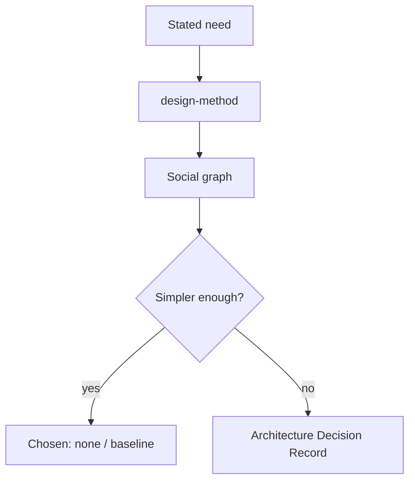

# Social graph — problem and solution

## Problem and forces

Edges grow huge; mutual friend queries explode if naively joined.

Forces typically include latency SLOs, consistency needs, cost, operability, and team skill.

## Naive approach and why it fails

- Two SQL tables scanned for every mutual query

## Solution

Adjacency lists; cache hot neighborhoods; consider graph DB only when earned; precompute counts; shard by user id; async rebuild for heavy analytics.

## Analogy (original)

Rolodex cards of who knows whom — not rereading the whole city directory.

## Structure

