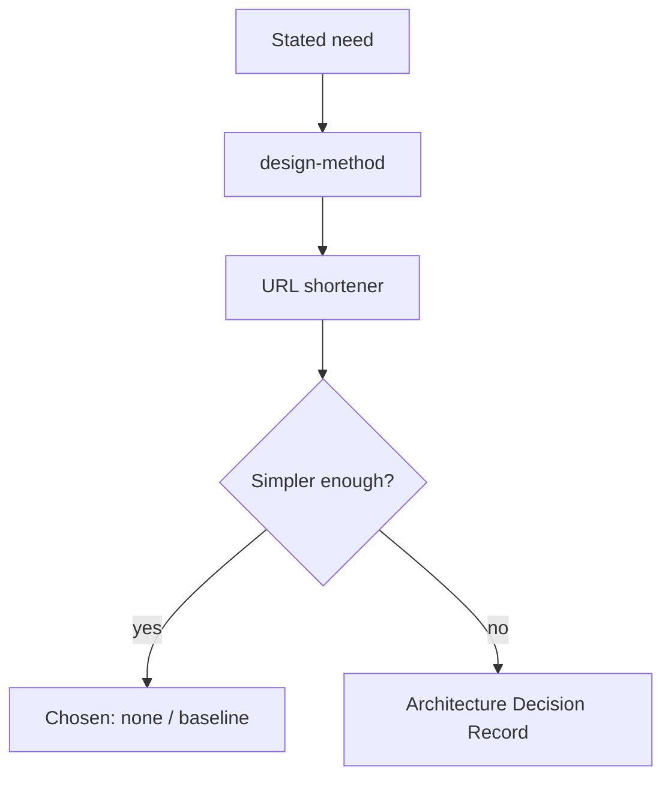

# URL shortener — problem and solution

## Problem and forces

Need short links, redirects, optional analytics, uniqueness under concurrency.

Forces typically include latency SLOs, consistency needs, cost, operability, and team skill.

## Naive approach and why it fails

- Auto-increment IDs exposed
- Sync write on every redirect analytics

## Solution

API to create mapping; 301/302 redirect path hot; encode unique IDs (base62); cache hot redirects; store analytics async; plan for hash collisions and abuse.

## Analogy (original)

Coat-check tickets for long URLs.

## Structure

