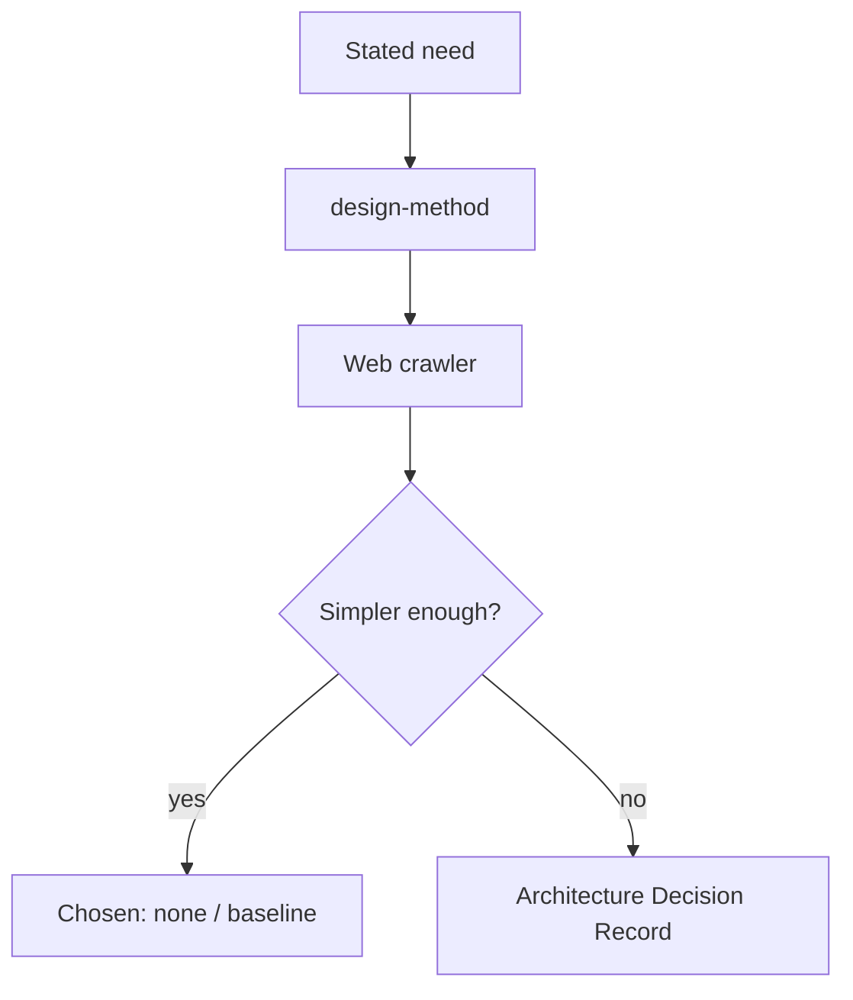

# Web crawler — problem and solution

## Problem and forces

Discover and fetch pages without DDOSing sites; dedupe URLs; handle politeness and scale.

Forces typically include latency SLOs, consistency needs, cost, operability, and team skill.

## Naive approach and why it fails

- Single-threaded BFS
- Ignore robots.txt

## Solution

URL frontier (priority + politeness); distributed fetchers; content store; seen-URL set; respect robots; isolate parse/extract; monitor bans.

## Analogy (original)

Library catalogers walking shelves with quiet hours and a map of visited aisles.

## Structure

