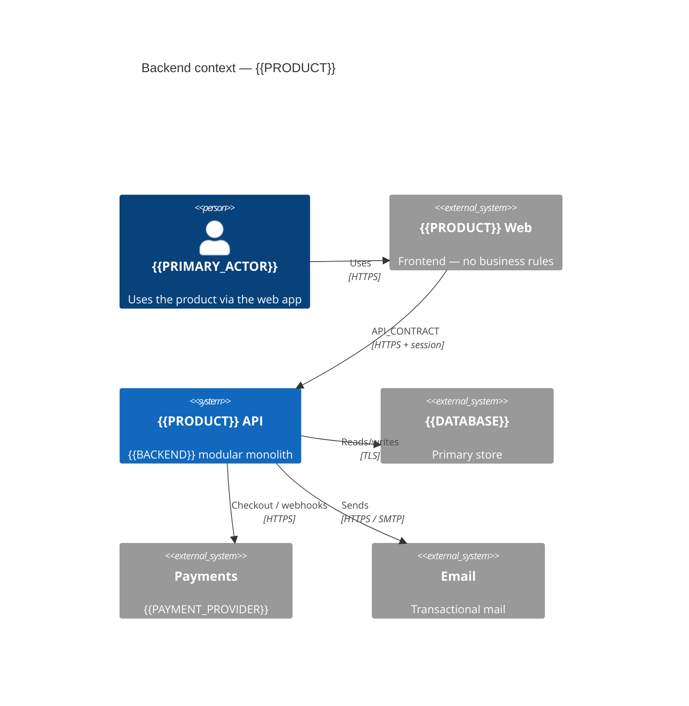
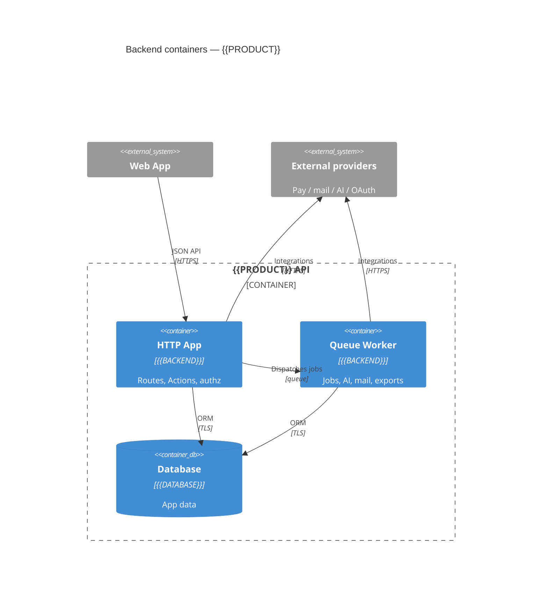

# Backend Architecture — {{PRODUCT}}

> ⚠️ **Planning only.** A proposal for the implementation repository. Libraries named here are proposals until they are added to [SRS §2](../SRS.md#2-technology-stack) with a verified version.

This file is the BE slice of the solution architecture (SAD craft mapped here — not a separate `SAD.md`). Pair with [`../frontend/ARCHITECTURE.md`](../frontend/ARCHITECTURE.md) and lasting choices in [`../DECISIONS.md`](../DECISIONS.md).

## 1. Principles

- Framework-native features first (auth, queues, validation, ORM) before extra services.
- Business rules live in one place, the backend.
- Prefer a **modular monolith**: one deployable app and database, code split by domain modules with Service Providers and public Actions — not microservices, not a flat ball-of-mud `app/` tree. Add a module toolkit package only if the product explicitly decides to.

## 2. Context (C4 Level 1)

Actors, the API boundary, and external systems (payments, email, AI providers, OAuth).



## 3. Containers (C4 Level 2)

Deployables: HTTP app, queue worker, scheduler, database — adjust to match DECISIONS / DEPLOYMENT.



## 4. Folder Structure

```text
app/
  Modules/{Name}/   Http, Models, Actions, Jobs, Providers, routes, migrations
  Shared/           cross-cutting helpers only (keep thin)
```

## 5. Request Lifecycle

Authentication → authorization (owner check) → validation → action → resource response.

## 6. Asynchronous Work

Which tasks run as queued jobs, how status is exposed, and how failures are retried.

If the product uses AI: prefer the framework AI SDK (or one thin OpenAI-compatible provider entry) over a custom multi-adapter layer; configure chat and embeddings separately; stamp the embedding model on each vector row and re-embed on model change (vectors from different models are not interchangeable).

## 7. Data and Privacy

Encryption of sensitive fields, retention, deletion, and data export.

## 8. Security

The SECURITY rules with Owner = BE or Both.

## 9. Testing

Full guide: [`TESTING.md`](TESTING.md). Feature tests per endpoint (including authorization); unit tests for business rules; fake external providers.

## 10. Deployment (initial production)

Hosting, database, queue worker, backups, and monitoring, kept to what the current actor needs in production; details in [`../DEPLOYMENT.md`](../DEPLOYMENT.md) and the [backend deployment guide](DEPLOYMENT.md).
