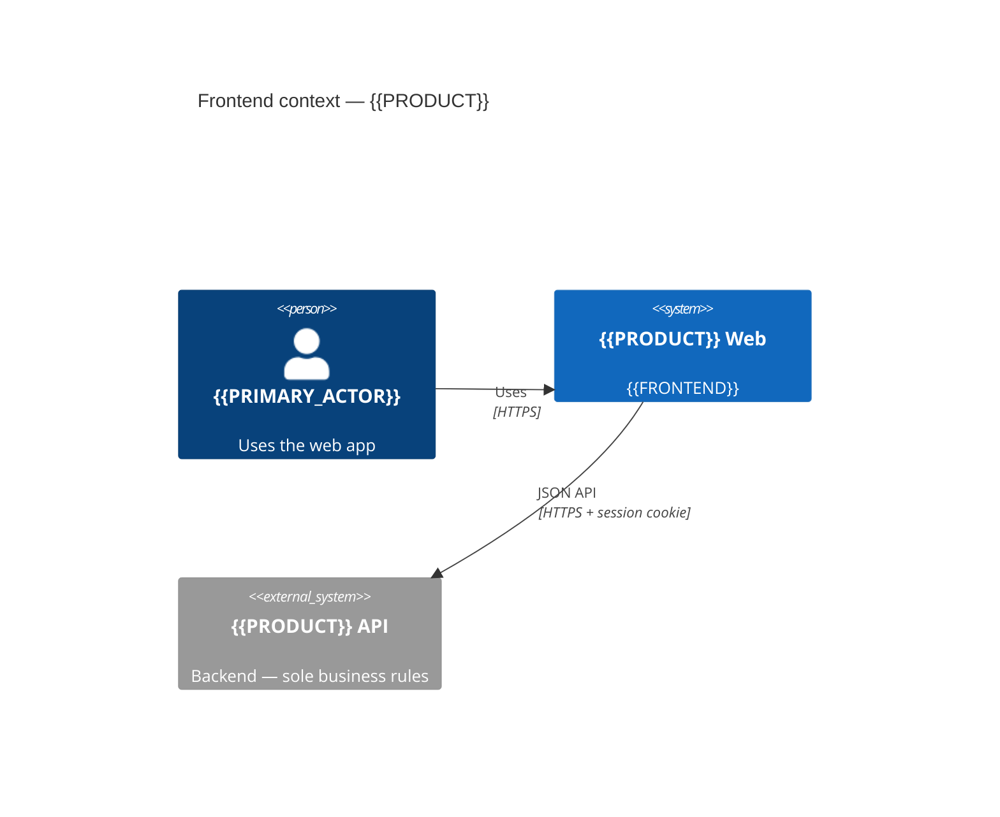
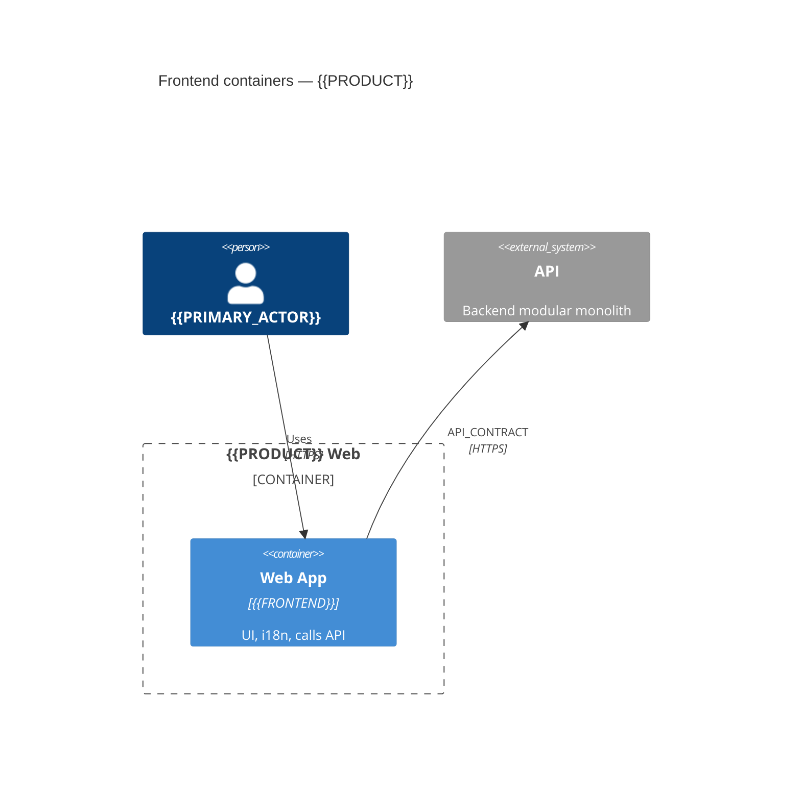

# Frontend Architecture — {{PRODUCT}}

> ⚠️ **Planning only.** A proposal for the implementation repository. Libraries named here are proposals until they are added to [SRS §2](../SRS.md#2-technology-stack) with a verified version.

This file is the FE slice of the solution architecture (SAD craft mapped here — not a separate `SAD.md`). Pair with [`../backend/ARCHITECTURE.md`](../backend/ARCHITECTURE.md) and lasting choices in [`../DECISIONS.md`](../DECISIONS.md).

## 1. Principles

- Framework-native features first; every extra library needs a reason.
- Server-side data access; the browser holds no secrets.
- Prefer a **frontend modular monolith** (one deployable app; feature/module folders, shared UI, one API client) — not micro-frontends and not a BFF that reimplements backend rules. Pair with a backend modular monolith so either side can extract a module later.

## 2. Context (C4 Level 1)

Who uses the frontend and which external systems it talks to (usually only the product API). Keep this diagram honest when actors or integrations change.



## 3. Containers (C4 Level 2)

Deployable / runtime pieces on the FE side (usually one Next.js app; add CDN or edge only if DECISIONS says so).



## 4. Rendering Strategy

Which pages are static, which are server-rendered, and which are client-only, and why.

## 5. Folder Structure (feature-based)

```text
src/
  app/          routes
  components/   shared UI
  features/     one folder per feature
  lib/          API client, i18n, utilities
```

## 6. Data Layer

How the app calls the API (one typed client generated from or matching [`API_CONTRACT.md`](../API_CONTRACT.md) §3), and how each contract error code is shown to the user.

## 7. Forms

Client validation for usability; server `422` errors shown next to their fields.

## 8. Internationalization and RTL

{{UI_LANGUAGES}}; logical CSS properties; the interface language never translates user content.

## 9. Styling and Design System

Tokens and components carried over from `project-ui/DESIGN.md`.

## 10. Security and Privacy

The SECURITY rules with Owner = FE or Both.

## 11. Testing

Full guide: [`TESTING.md`](TESTING.md). Unit/component for client logic; short E2E list; accessibility on critical journeys.

## 12. From Prototype to Product

What moves over from `project-ui/` (design tokens, components, copy, screen IDs) and what is rebuilt (data fetching, auth).
